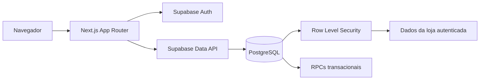

# ModaStore

[](https://github.com/luizzangelo/modastore/actions/workflows/ci.yml)
[](LICENSE)
[](https://nextjs.org/)
[](https://supabase.com/)

Sistema open source de gestão multi-loja para pequenos e médios varejistas de moda. O ModaStore reúne estoque por tamanho, clientes, vendas, crediário, contas a receber e indicadores em uma aplicação web responsiva.

Cada conta é proprietária de uma loja isolada. A separação dos dados não depende apenas da interface: ela é aplicada no PostgreSQL por políticas de Row Level Security (RLS).

## Funcionalidades

- Autenticação por e-mail e senha com sessões seguras no servidor.
- Isolamento multi-tenant: cada usuário acessa somente a própria loja.
- Cadastro de produtos com grade de tamanho único ou `P`, `M`, `G` e `GG`.
- Controle de estoque por variação, estoque mínimo e alerta de reposição.
- Cadastro e histórico de clientes, com pesquisa durante a venda.
- Vendas itemizadas ou manuais por PIX, cartão, dinheiro ou fiado.
- Baixa de estoque e criação de parcelas na mesma transação.
- Contas a receber com filtros, pagamentos parciais, quitação e estorno.
- Cancelamento seguro de vendas e restauração de estoque.
- Dashboard com faturamento, lucro, peças vendidas e valores a receber.
- Relatórios com períodos rápidos, gráficos mensais e ranking de clientes.
- Exportação do histórico de vendas em CSV e comprovante de venda.
- Configuração do nome da loja e alteração de senha.

## Arquitetura



O navegador recebe apenas a URL e a chave publicável do Supabase. Server Components e Server Actions cuidam das operações da aplicação, enquanto RLS e funções transacionais protegem o banco contra acesso entre lojas e gravações financeiras incompletas.

## Tecnologias

- Next.js 16, React 19 e TypeScript estrito
- Tailwind CSS 4
- Supabase Auth, PostgreSQL, RLS e `@supabase/ssr`
- Zod para validação
- Recharts para visualização dos relatórios
- Vitest, Testing Library, Playwright e pgTAP
- Docker, Docker Swarm, Traefik e GitHub Actions

## Pré-requisitos

- Node.js 24 ou superior
- pnpm 12.11.2
- Docker Desktop ou Docker Engine para o Supabase local
- Supabase CLI, instalada pelas dependências do projeto

## Início rápido

```bash
git clone https://github.com/luizzangelo/modastore.git
cd modastore
corepack enable
pnpm install
cp .env.example .env.local
pnpm exec supabase start
pnpm exec supabase db reset
```

Use os valores exibidos por `pnpm exec supabase status` para preencher em `.env.local`:

```dotenv
NEXT_PUBLIC_SUPABASE_URL=http://127.0.0.1:54321
NEXT_PUBLIC_SUPABASE_PUBLISHABLE_KEY=sua_chave_publicavel_local
NEXT_PUBLIC_ALLOW_SIGNUP=false
NEXT_PUBLIC_APP_URL=http://localhost:3000
DEPLOYMENT_VERSION=development
```

Inicie a aplicação:

```bash
pnpm dev
```

Acesse [http://localhost:3000](http://localhost:3000). O seed local contém contas fictícias exclusivas para desenvolvimento; consulte o comentário no início de [`supabase/seed.sql`](supabase/seed.sql).

## Variáveis de ambiente

| Variável                               | Uso                                                 |
| -------------------------------------- | --------------------------------------------------- |
| `NEXT_PUBLIC_SUPABASE_URL`             | URL pública do projeto Supabase                     |
| `NEXT_PUBLIC_SUPABASE_PUBLISHABLE_KEY` | Chave publicável protegida pelas políticas RLS      |
| `NEXT_PUBLIC_ALLOW_SIGNUP`             | Habilita ou oculta o cadastro público               |
| `NEXT_PUBLIC_APP_URL`                  | URL pública da aplicação                            |
| `NEXT_SERVER_ACTIONS_ENCRYPTION_KEY`   | Chave base64 de 32 bytes usada no build de produção |
| `DEPLOYMENT_VERSION`                   | Identificador único da versão publicada             |
| `APP_HOST`                             | Host usado pelo manifesto opcional do Traefik       |

Nunca use a senha do PostgreSQL, uma secret key ou uma chave `service_role` no frontend. Arquivos `.env*` são ignorados, com exceção do modelo seguro [`.env.example`](.env.example).

## Comandos úteis

```bash
pnpm dev          # servidor de desenvolvimento
pnpm build        # build otimizado de produção
pnpm lint         # ESLint
pnpm typecheck    # verificação do TypeScript
pnpm test         # testes unitários
pnpm test:e2e     # testes completos no navegador
pnpm db:lint      # lint do schema PostgreSQL
pnpm db:test      # testes pgTAP de regras e isolamento
pnpm db:types     # regenera os tipos TypeScript do banco local
```

Para executar toda a suíte E2E, mantenha o Supabase local e o Docker ativos. O Docker não precisa permanecer aberto para usar uma instalação já publicada em outra máquina.

## Banco de dados e segurança

As migrations ficam em [`supabase/migrations`](supabase/migrations) e podem recriar o schema integralmente. Entre as proteções implementadas estão:

- RLS habilitada e forçada nas tabelas de negócio.
- Associação obrigatória de cada registro a uma loja.
- Views com `security_invoker`.
- Funções privilegiadas com `search_path` vazio, validação do usuário e permissões explícitas.
- Operações atômicas para vendas, estoque, parcelas, pagamentos e cancelamentos.
- Testes pgTAP que comprovam o isolamento entre duas lojas.

Mais detalhes estão em [docs/database.md](docs/database.md) e [docs/architecture.md](docs/architecture.md).

## Docker e publicação

Para testar o container localmente:

```bash
cp .env.example .env
docker compose up --build
```

O projeto também inclui um manifesto de referência para Docker Swarm com Traefik, healthcheck, atualização gradual, rollback e limites de recursos. Consulte [docs/deployment.md](docs/deployment.md) antes de publicar.

## Estrutura do projeto

```text
src/app/             rotas, páginas e layouts
src/components/      componentes visuais reutilizáveis
src/features/        regras e interfaces agrupadas por domínio
src/lib/             integrações e utilitários
src/types/           tipos gerados do banco
supabase/migrations/ schema PostgreSQL versionado
supabase/tests/      testes pgTAP
tests/e2e/           fluxos críticos no navegador
deploy/              manifesto de produção
docs/                arquitetura, banco e publicação
```

## Contribuição

Contribuições são bem-vindas. Leia [CONTRIBUTING.md](CONTRIBUTING.md), mantenha mudanças pequenas, adicione testes e use Conventional Commits.

Problemas de segurança não devem ser publicados em issues. Siga as orientações de [SECURITY.md](SECURITY.md).

## Licença

Distribuído sob a [Licença MIT](LICENSE).
